# ERD v1 — QL_ThoiTrangTreEm

> Deliverable Tuần 2 (issue #5) · Schema v1.0 · Owner: **Sử**
> Bản vẽ tương tác: [`ERD.dbml`](ERD.dbml) — dán vào [dbdiagram.io](https://dbdiagram.io) để xem/sửa.
> Script chuẩn: [`../Database/QL_ThoiTrangTreEm.sql`](../Database/QL_ThoiTrangTreEm.sql).

## 1. Sơ đồ quan hệ (Mermaid — hiển thị trực tiếp trên GitHub)

```mermaid
erDiagram
    USERS ||--o{ ORDERS : "đặt hàng"
    CATEGORIES ||--o{ CATEGORIES : "cha - con"
    CATEGORIES ||--o{ PRODUCTS : "phân loại"
    PRODUCTS ||--o{ PRODUCT_VARIANTS : "có biến thể"
    PRODUCTS ||--o{ PRODUCT_IMAGES : "có ảnh"
    ORDERS ||--o{ ORDER_DETAILS : "gồm"
    PRODUCT_VARIANTS ||--o{ ORDER_DETAILS : "được đặt"
    PRODUCTS ||--o{ PRODUCT_PROMOTIONS : "tham gia"
    PROMOTIONS ||--o{ PRODUCT_PROMOTIONS : "áp dụng cho"

    USERS {
        int UserId PK
        nvarchar Username UK
        varchar PasswordHash
        nvarchar FullName
        varchar Email UK
        varchar Phone
        nvarchar Address
        varchar Role
        bit IsActive
        datetime CreatedDate
    }

    CATEGORIES {
        int CategoryId PK
        nvarchar CategoryName
        int ParentId FK
        nvarchar Description
        bit IsActive
    }

    PRODUCTS {
        int ProductId PK
        nvarchar ProductName
        int CategoryId FK
        decimal Price
        nvarchar Description
        varchar MainImage
        varchar Gender
        datetime CreatedDate
        bit IsActive
    }

    PRODUCT_VARIANTS {
        int VariantId PK
        int ProductId FK
        varchar Size
        nvarchar Color
        int StockQuantity
    }

    PRODUCT_IMAGES {
        int ImageId PK
        int ProductId FK
        varchar ImageUrl
        int SortOrder
    }

    ORDERS {
        int OrderId PK
        int UserId FK
        datetime OrderDate
        nvarchar ReceiverName
        varchar Phone
        nvarchar ShippingAddress
        decimal TotalAmount
        varchar Status
        nvarchar Note
    }

    ORDER_DETAILS {
        int OrderDetailId PK
        int OrderId FK
        int VariantId FK
        int Quantity
        decimal UnitPrice
    }

    PROMOTIONS {
        int PromotionId PK
        nvarchar PromotionName
        int DiscountPercent
        date StartDate
        date EndDate
        bit IsActive
    }

    PRODUCT_PROMOTIONS {
        int ProductId PK,FK
        int PromotionId PK,FK
    }
```

## 2. Quan hệ và bội số

| Quan hệ | Bội số | Ý nghĩa nghiệp vụ |
|---|---|---|
| `Users` → `Orders` | 1–N | Một khách có nhiều đơn; mỗi đơn thuộc đúng 1 khách |
| `Categories` → `Categories` | 1–N (tự thân) | Danh mục 2 cấp: `ParentId = NULL` là danh mục cha |
| `Categories` → `Products` | 1–N | Mỗi sản phẩm thuộc 1 danh mục |
| `Products` → `ProductVariants` | 1–N | Mỗi sản phẩm có nhiều size/màu, mỗi variant có tồn kho riêng |
| `Products` → `ProductImages` | 1–N | Ảnh chính + ảnh phụ, sắp theo `SortOrder` |
| `Orders` → `OrderDetails` | 1–N | Một đơn gồm nhiều dòng hàng |
| `ProductVariants` → `OrderDetails` | 1–N | Mỗi dòng đơn trỏ tới đúng variant đã mua + giá tại thời điểm mua |
| `Products` ↔ `Promotions` | N–N qua `ProductPromotions` | Một khuyến mãi áp cho nhiều sản phẩm và ngược lại |

## 3. Quyết định thiết kế quan trọng (dùng để vấn đáp)

1. **Giá lưu ở `OrderDetails.UnitPrice`, không chỉ lấy từ `Products.Price`.**
   Vì giá sản phẩm có thể thay đổi sau khi khách đặt; đơn cũ phải giữ đúng giá lúc mua.
2. **Giỏ hàng không có bảng riêng** — lưu `Session["Cart"]` theo yêu cầu môn học.
   Chỉ khi khách xác nhận đặt hàng mới ghi `Orders` + `OrderDetails`.
3. **Tồn kho nằm ở `ProductVariants`, không nằm ở `Products`.**
   Vì mỗi size/màu có số lượng riêng; thêm giỏ phải kiểm tra đúng variant.
4. **`OrderDetails` trỏ tới `VariantId`** (không trỏ `ProductId`) để biết chính xác size/màu khách mua.
5. **Danh mục tự tham chiếu `ParentId`** để làm menu 2 cấp động (F02), không hard-code.
6. **Không xóa cứng dữ liệu đã phát sinh đơn** — dùng `IsActive = 0` để giữ lịch sử và tránh lỗi khóa ngoại.
7. **`Products.Gender`** (Boy/Girl/Unisex) phục vụ bộ lọc/nhóm đối tượng ngoài danh mục.

## 4. Tập giá trị chuẩn

| Trường | Giá trị | Ràng buộc |
|---|---|---|
| `Users.Role` | `Customer`, `Admin` | CHECK |
| `Orders.Status` | `Pending`, `Confirmed`, `Shipping`, `Completed`, `Cancelled` | CHECK |
| `Products.Gender` | `Boy`, `Girl`, `Unisex`, `NULL` | CHECK |
| `Promotions.DiscountPercent` | 0–100 | CHECK |
| `Promotions` ngày | `StartDate <= EndDate` | CHECK |
| `ProductVariants` | `(ProductId, Size, Color)` duy nhất | UNIQUE |

## 5. Đối chiếu với rubric

| Chức năng | Bảng liên quan |
|---|---|
| F02 Menu 2 cấp | `Categories` (ParentId) |
| F03–F08 Danh sách/chi tiết/lọc/search/related | `Products`, `Categories`, `ProductVariants`, `ProductImages` |
| F09–F10 Đăng ký/đăng nhập | `Users` + Session |
| F11–F12 Giỏ hàng | Session `CartItem` + `ProductVariants` (kiểm tra tồn kho) |
| F13–F15 Checkout/lịch sử | `Orders`, `OrderDetails` |
| F16–F19 CRUD + quản lý đơn | `Categories`, `Products`, `ProductVariants`, `ProductImages`, `Orders` |
| F20 Khuyến mãi | `Promotions`, `ProductPromotions` |
| F21 Doanh thu | `Orders` (Status = Completed) |
| F23 Web API | `Products` + EF context dùng chung |

## 6. Cách cập nhật ERD

1. Sửa `ERD.dbml` → dán vào dbdiagram.io → Export PNG/SVG nếu cần cho báo cáo.
2. Cập nhật lại khối Mermaid ở mục 1 cho khớp.
3. Nếu thay đổi cấu trúc bảng: cập nhật `Database/QL_ThoiTrangTreEm.sql` + changelog
   trong [`THIET_KE_DATABASE.md`](THIET_KE_DATABASE.md) mục 6.
4. Thông báo nhóm trước khi merge (điểm giao tiếp bắt buộc).
